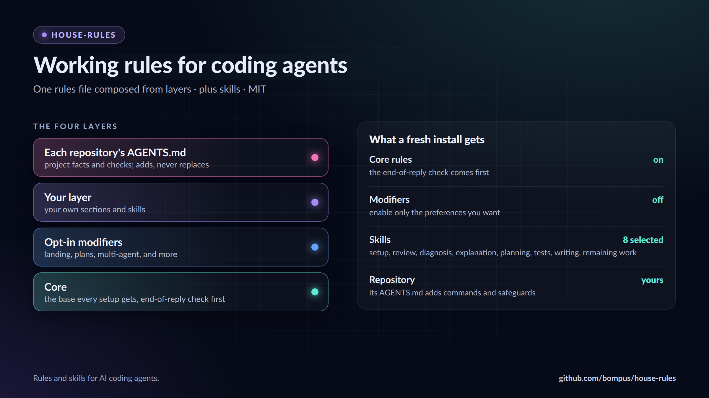

<h1 align="center">
  <picture>
    <source media="(prefers-color-scheme: dark)" srcset="https://raw.githubusercontent.com/bompus/house-rules/HEAD/docs/assets/banner-dark.png">
    
  </picture>
</h1>

<p align="center">
  <a href="https://github.com/bompus/house-rules/actions/workflows/check.yml"></a>
  <a href="https://github.com/bompus/house-rules/releases/latest"></a>
  <a href="https://www.npmjs.com/package/@bompus/house-rules"></a>
  <a href="LICENSE"></a>
</p>

<p align="center">
  <a href="rules/core.md">Core rules</a>&nbsp;·
  <a href="#modifiers">Opt-in modifiers</a>&nbsp;·
  <a href="#writing-your-own-sections">Your own layer</a>&nbsp;·
  <a href="examples/project/AGENTS.md">Each repo's AGENTS.md</a>
</p>

A practical starting point for ordinary development with AI coding agents.
Fresh installs select eight skills for setup, review, diagnosis, explanation,
planning, tests, writing and remaining work. Modifiers start off. Add guidance
when a task needs it, and let each repository supply its own safeguards.

<p align="center"></p>

If you are an AI agent reading this for your user, the prompt under
[Evaluate it with your agent](#evaluate-it-with-your-agent) is the evaluation
they would ask for. Summarize how it fits their setup and let them choose;
don't install or copy anything on your own.

## How the layers fit

1. **Core** (`rules/core.md`): the base every setup gets. Its first section is
   the end-of-reply check, so an agent that reads only the top of the file
   still knows when to keep working and when to stop and ask.
2. **Optional rules**, called modifiers in the files (`rules/modifiers/`): opt-in preferences, such as coded
   option lists or squash-only landing. Each one replaces a core section or
   adds a section after one.
3. **Your own rules**, called your layer in the files (by default `~/.config/house-rules/`): `house-rules.json`
   names the modifiers you enable, `rules/` holds your own sections, and
   `skills/` holds your own skills. A skill there replaces the house-rules
   skill of the same name. The config's other keys are optional: `layers`
   lists layer directories relative to the config (default `["."]`, its own
   directory). `skills.include` selects shipped skills; omitting it keeps the
   full shipped set for existing configs. Personal skills remain included.
   `skills.exclude` leaves names out of every layer. `skills.independent` records
   generic personal names you intend to keep beside renamed house-rules skills.
4. **The repository** (`AGENTS.md`, `CLAUDE.md` or your host's equivalent):
   its commands, branch names, safeguards, required checks and landing path.
   It adds to your rules and does not replace them. See
   `examples/project/AGENTS.md` for the pattern: point at the house rules
   instead of restating them, and add only what the project needs.

`compose.mjs` merges layers 1 to 3 into one rules file. A replaced section
leaves no trace of the old text, because an agent given two versions of a rule
tends to follow either one. Composition fails on a duplicate heading, an
unknown target or any attempt to replace the end-of-reply check.

## Quick start

Requires `git` and either [Bun](https://bun.sh) 1.4 or newer or Node.js 22 or
newer. On Linux, macOS or WSL, one line installs or updates the selected guidance:

```bash
curl -fsSL https://raw.githubusercontent.com/bompus/house-rules/main/install.sh | sh
```

On Windows 10 or 11, run this in PowerShell instead:

```powershell
irm https://raw.githubusercontent.com/bompus/house-rules/main/install.ps1 | iex
```

To read the script before it runs:

```bash
curl -fsSLO https://raw.githubusercontent.com/bompus/house-rules/main/install.sh
less install.sh
sh install.sh
```

```powershell
irm https://raw.githubusercontent.com/bompus/house-rules/main/install.ps1 -OutFile install.ps1
notepad install.ps1
powershell -ExecutionPolicy Bypass -File install.ps1
```

The script picks the newest Bun 1.4 or newer it finds on `PATH` or in a
version manager's directory, otherwise the newest Node.js 22 or newer. It
clones this repository to `~/.local/share/house-rules` (or pulls it when it is
already there), copies `examples/person/house-rules.json` to
`~/.config/house-rules/` when you have no config yet, and composes
`~/.config/house-rules/rules.md` and `~/.config/house-rules/composed-skills`.
Those are the default paths: a set `XDG_DATA_HOME` replaces `~/.local/share`,
and a set `XDG_CONFIG_HOME` replaces `~/.config`. On Windows the checkout goes
to `%LOCALAPPDATA%\house-rules` and the config to
`%USERPROFILE%\.config\house-rules`.
The fresh config selects the eight skills named above and no modifiers.
Updates preserve your existing config. An explicit `skills.include` list keeps
later shipped additions off until selected. Browse the full catalog only when
you want more choices.

On a later run, if the composed skills changed, it keeps the previous skills
directory under a dated name instead of deleting it; if they match, it says so
and keeps nothing extra. It never edits an agent host's files. The comment at
the top of `install.sh` lists the environment variables that change its paths
or runtime; `install.ps1` takes the same variables. Some skill scripts need Bun
even when Node.js composes the rules.

Then connect the composed file to your agent. Claude Code reads
`@~/.config/house-rules/rules.md` on its own line in `~/.claude/CLAUDE.md`;
other hosts take a copy in their user-level rules file, with the
`house-rules-references/` directory placed beside it. Written rules link to the
procedures in that directory, which hold detail; an agent may act without opening
one, so each guard stays written in the rules themselves. Stdout and configuration
previews keep the procedures inline. See [reference output](docs/configuration.md#reference-output). To change modifiers or
skills, change to the checkout directory and run `node compose.mjs setup`,
or `bun compose.mjs setup` when Node.js is unavailable. Review the numbered
choices and use `save` to change only the configuration. Setup then prints the
command that applies the selection: the installer for a checkout, or
`house-rules --config` for the npm package.
The [configuration CLI guide](docs/configuration.md) covers status, previews,
question preferences, optional panel preferences and safe writes. The
`hr-house-rules-setup` skill preserves selections, offers relevant additions and connects
hosts, and asks before it touches a host file.

### npm distribution

`@bompus/house-rules` is published to npm. The package provides the
`house-rules` composition and configuration commands. Installation has no
lifecycle hooks and does not connect an agent host or change its settings.

```bash
npm install --global @bompus/house-rules
house-rules --list
house-rules config help
house-rules --config ./house-rules.json --out ./rules.md --skills-out ./composed-skills
```

Create your configuration before composing. The
[configuration guide](docs/configuration.md) describes the available choices.
The package bundles rules, skills, their resources and documentation. With the
npm package, run `house-rules setup` to change modifiers or skills. Git-based
installers follow the default branch; npm follows published versions.

### Manual steps

To keep the checkout somewhere else, run the same steps by hand. The commands use `node`; `bun` runs them the same way.

```bash
git clone https://github.com/bompus/house-rules.git
cd house-rules
node compose.mjs --list
mkdir -p ~/.config/house-rules
cp examples/person/house-rules.json ~/.config/house-rules/
node compose.mjs --config ~/.config/house-rules/house-rules.json \
  --out ~/.config/house-rules/rules.md --skills-out ~/.config/house-rules/composed-skills
```

To recompose later, move or remove the old `composed-skills` directory first,
because `--skills-out` must be empty or absent. `compose.mjs` writes the rules
file, a `house-rules-references/` directory beside it (or at `--references-out`)
when the rules include reference procedures, and `--skills-out` when given. It never deletes anything.

When distributing a rules-only output, carry this checkout's `LICENSE` and
`THIRD_PARTY_NOTICES.md` alongside it. Copy them into an explicit destination
and reconcile existing notice files before replacing them. A full
`--skills-out` export already includes both at its root. When copying one
skill, keep its entire directory, including any `NOTICE.md` and `LICENSE`.
Personal layers must also carry notices required by their own sources.

## Upgrading skill names

All shipped skill names use `hr-`. Before updating an older installation,
follow [the skill name upgrade guide](docs/skill-names.md) to preserve exclusions
and personal overrides. Composition stops on ambiguous old names before
writing output. Host links and copies need a separate update.

## Evaluate it with your agent

Paste this into a session with the agent you use. It compares house-rules with
the rules you already have and changes nothing until you choose.

```text
I'm considering house-rules (https://github.com/bompus/house-rules), working
rules and skills for AI coding agents. Read its README, rules/core.md,
rules/modifiers/ and the skills list, then compare them with the rules and
skills I already use (my user-level rules file for this host and this
repository's AGENTS.md or equivalent). Tell me:
1. Which rules, modifiers or skills would change how you work with me, with
   an example from how you work now.
2. Which ones duplicate or conflict with what I already have.
3. Whether to adopt it whole (compose.mjs plus my own layer) or copy single
   sections into my existing rules. Taking individual ideas is fine.
Read only: don't install, compose or edit anything until I choose. When I
adopt a section or idea, record its source in distributed notices, such as
"Adapted from house-rules (https://github.com/bompus/house-rules)". Keep required
licence notices with copied text and standalone skill bundles.
```

Taking individual ideas is welcome. If you adopt any, we'd appreciate a
source credit in your distributed notices. Copying substantial text also needs
the MIT notice kept (see `LICENSE`).

## Writing your own sections

A rules file in your layer starts with frontmatter that names one operation
and a core heading, followed by its own `## ` heading:

```markdown
---
after: Implementation economy
---

## My tooling

Use pnpm for JavaScript projects unless the repository uses another manager.
```

The operations are `replaces:`, `after:`, `before:` and `removes:`; a
`removes:` file has no body. A file without frontmatter is added at the end.
Frontmatter may also hold `description:`, `requires:` (a comma-separated
list of skills the section relies on; the core rules and any modifier that relies
on skills declare them, and composing warns when one is not in the composed
set) and `reference:` (a procedure file the section links to; see
[reference output](docs/configuration.md#reference-output)); any other key is an error. Files apply
in name order, after the modifiers.

## Modifiers

| &nbsp;&nbsp;&nbsp;&nbsp;&nbsp;&nbsp;&nbsp;&nbsp;&nbsp;&nbsp;&nbsp;&nbsp;Modifier&nbsp;&nbsp;&nbsp;&nbsp;&nbsp;&nbsp;&nbsp;&nbsp;&nbsp;&nbsp;&nbsp;&nbsp; | What it does                                                                                                                                                                                                                                                          |
| -------------------------------------------------------------------------------------------------------------------------------------------------------- | --------------------------------------------------------------------------------------------------------------------------------------------------------------------------------------------------------------------------------------------------------------------- |
| `backlog-outline`                                                                                                                                        | A backlog report adds a Markdown outline of every open item grouped by what it waits on; nothing is rendered, so it reads the same on every host.                                                                                                                     |
| `backlog-visual`                                                                                                                                         | A backlog report adds one dark panel of every open item grouped by what it waits on, with a table for waiting items and one row per decision; hosts without a render tool get the same outline in Markdown.                                                           |
| `code-over-stale-docs`                                                                                                                                   | When documentation and existing code disagree, follow the code's conventions and report each mismatch, unless the documentation marks the code legacy or being migrated.                                                                                              |
| `coded-offers`                                                                                                                                           | Offers use numbered questions and coded options (`1a`, `1b`) so one short reply answers every decision.                                                                                                                                                               |
| `compact-reviews`                                                                                                                                        | Substantive review judgments use Decision, Evidence and applicable action, verification and limit labels; required review formats stay intact and work-status summaries do not repeat findings.                                                                       |
| `compression-codecs`                                                                                                                                     | Prefer zstd, then brotli, then gzip for data you write, with browser negotiation, gzip exceptions and measured levels.                                                                                                                                                |
| `cross-session-relay`                                                                                                                                    | Relayed work between sessions keeps its source and authorized scope, and an authorized push that changes inherited guidance or tooling is announced to the affected sessions.                                                                                         |
| `effort-estimates`                                                                                                                                       | Options that differ in cost, or work that waits on CI, a build or a deploy, carry a wall-clock estimate based on comparable finished work. Estimates from workers, docs or other models are converted the same way or dropped.                                        |
| `land-when-done`                                                                                                                                         | Authorized repository work is not finished until it is in the remote default branch.                                                                                                                                                                                  |
| `low-quota-handoff`                                                                                                                                      | When the current model's usage allowance runs low, write a handoff before work stops.                                                                                                                                                                                 |
| `model-default-questions`                                                                                                                                | Leave how questions are asked to your host and model, with no text-only or question-card instruction.                                                                                                                                                                 |
| `multi-agent`                                                                                                                                            | Work is split across delegated workers and several agent hosts; worker reports, review standards and cleanup checks account for all of them.                                                                                                                          |
| `no-attribution`                                                                                                                                         | Commits, pull requests and comments carry no agent or tool credit lines unless the target repository asks for a disclosure.                                                                                                                                           |
| `periodic-updates`                                                                                                                                       | A job expected to run longer than about 10 minutes posts a short status update every 5 minutes by default, with progress, an ETA with its basis or "unmeasured", and findings so far, until the job ends; a watcher event that changes nothing gets at most one line. |
| `plan-files`                                                                                                                                             | Multi-step work keeps a visible task list mirrored to a plan file with a ledger of every item's outcome.                                                                                                                                                              |
| `question-cards`                                                                                                                                         | Opt in to question cards beside complete text offers when the host supports them; availability and presentation can vary by host, provider and model.                                                                                                                 |
| `release-batching`                                                                                                                                       | Batch approved, compatible changes for releases and audit factual claims before releases or public announcements.                                                                                                                                                     |
| `scratch-on-disk`                                                                                                                                        | Task scratch lives on disk under the user data directory, never in RAM-backed `/tmp`.                                                                                                                                                                                 |
| `shared-host-load`                                                                                                                                       | Only benchmarks and other performance measurements wait for a quiet host. Other work runs whatever the load; while an isolated measurement runs, competing work follows its isolation rules. Very large jobs still run under a memory cap.                            |
| `solo-operator`                                                                                                                                          | For repositories with one maintainer, the user's direction is the review; no review-gated steps.                                                                                                                                                                      |
| `squash-landing`                                                                                                                                         | Pull requests land by squash merge after review-bot findings are handled, and the session's checkout moves off the landed branch.                                                                                                                                     |
| `upstream-contributions`                                                                                                                                 | A measured optimization, fix or defect found in a third-party project is offered for submission to that project through its own contribution route.                                                                                                                   |
| `web-image-formats`                                                                                                                                      | Prefer WebP for web raster images when it saves bytes at acceptable quality, with format exceptions and delivered-file checks.                                                                                                                                        |

Questions use text only by default. Setup asks how you want questions asked:

- **Model default**: house-rules gives no instruction, so your model and host ask
  their usual way (`model-default-questions`).
- **Text only**: plain text options, with or without short reply codes such as
  `1a` (`coded-offers`). No question tools are called, even when the host
  exposes them.
- **Clickable choices when available**: complete text options plus a
  question card (`question-cards`). Cards can be unavailable, skipped or shown
  unexpectedly across hosts, providers and models; the text offer remains usable
  on its own.

`hr-house-rules-setup` asks which you want and explains these limits before
changing the configuration.

## Skills

| Skill                       | Use it to                                                                                                 |
| --------------------------- | --------------------------------------------------------------------------------------------------------- |
| `hr-agent-guidance-audit`   | Audit agent guidance for stale or conflicting rules, and decide what to retire or merge.                  |
| `hr-agent-guidance-refresh` | Re-read guidance that changed since the session started.                                                  |
| `hr-api-exposure-check`     | Keep API responses to the fields a consumer reads and the caller may see.                                 |
| `hr-audit-choices`          | List and check the decisions made while implementing a task.                                              |
| `hr-benchmarking`           | Design, run and assess timing, CPU and memory comparisons; choose tools by the question they answer.      |
| `hr-better-accessibility`   | Build and review keyboard access, semantics, forms, focus, motion and reflow in web UI.                   |
| `hr-better-colors`          | Choose and check palettes, semantic tokens, themes, gamut and rendered contrast.                          |
| `hr-better-layout`          | Build and review grouping, alignment, spacing, responsive layout and clipping.                            |
| `hr-better-typography`      | Style and review type scales, wrapping, spacing, truncation and font loading.                             |
| `hr-better-writing`         | Write and review interface labels, errors, empty states and product terminology.                          |
| `hr-code-review`            | Review a diff against standards and the request, and check what it can break beyond its lines.            |
| `hr-design-exploration`     | Compare visual directions, or variants of one component, and refine toward one design.                    |
| `hr-diagnosing-bugs`        | Work a hard bug or regression to a confirmed cause.                                                       |
| `hr-explain-code`           | Trace how existing code works, read-only, before changing it.                                             |
| `hr-extract-shared-steps`   | Move operations repeated across workflows into shared functions.                                          |
| `hr-forgotten-work-audit`   | Audit past sessions, plans and handoffs for promised work that dropped off every list.                    |
| `hr-handoff`                | Write a handoff a fresh session can resume from.                                                          |
| `hr-house-rules-setup`      | Choose modifiers, create your layer and connect your hosts.                                               |
| `hr-issue-tracker-setup`    | Configure project tracker, domain-term and ADR conventions; explicit-only.                                |
| `hr-lean-plan`              | Write or tighten an implementation plan with the fewest moving parts.                                     |
| `hr-maintainability-review` | Review a diff or entire codebase strictly for structure, over-engineering and leftover scaffolding.       |
| `hr-manual-qa`              | Give reproducible human checks after reporting agent verification results.                                |
| `hr-navigation-retro`       | Audit navigation failures in selected transcripts and propose verified findability fixes.                 |
| `hr-ordering-tests`         | Enumerate event orderings through the real code to find race bugs.                                        |
| `hr-plain-prose`            | Make text people read plain and specific.                                                                 |
| `hr-progress-report`        | Report current task activity, milestone completion and remaining wall-clock time.                         |
| `hr-pr-followup`            | Address conflicts, feedback and failing checks for a PR; landing authority; CodeRabbit and cubic gate.    |
| `hr-read-reddit`            | Read Reddit feed output while supported; RSS support ends November 13, 2026. Partial web-search fallback. |
| `hr-read-x-links`           | Read the full content of X posts.                                                                         |
| `hr-research-shared-links`  | Research a shared link or repository in depth, compare it with your setup and rate each idea.             |
| `hr-sqlite`                 | Check settings, locking, queries and copies in SQLite code against measured findings.                     |
| `hr-stock-ui-audit`         | Find and triage template-default styling in frontend code.                                                |
| `hr-tdd`                    | Implement requested test-first work through one red-green slice at a time; simplify during review.        |
| `hr-test-audit`             | Decide which new tests are worth keeping and which old ones to prune.                                     |
| `hr-usage-report`           | Measure where agent usage went by provider, model and role, and chart model comparisons.                  |
| `hr-what-next`              | Reconcile remaining session work and recommend priorities when asked what comes next.                     |
| `hr-writing-for-agents`     | Write skills, rules and other documents agents read.                                                      |
| `hr-writing-pr`             | Write a pull request title and body from the final diff; split work into several PRs.                     |

The `hr-navigation-retro` skill finds navigation failures in selected tool-call
transcripts, then proposes fixes verified against current source. Any agent with
file and shell access can run it. Supported inputs include Claude Code, Codex,
OpenCode exports, Cursor CLI streams and ACP v1 recordings from other agents.
See its [input limits](skills/hr-navigation-retro/references/inputs.md).
It requires Python 3.11+ and keeps reports local.

## Checking the rules against your models

`evals/end-of-reply/` (in the GitHub repository, not the npm package) runs short scenarios through any model CLI. It grades
whether the agent keeps working or ends with an offer at the right time,
including when it reads only the first 80 lines. A 2026-10-11 replay covered
its 18 scenarios, two runs each, on Claude Code 2.1.296 only, at revision
`efd4d7b`; `rules/core.md` has changed since. The rules scored
22 of 36 replies with Opus 5.5 and 27 of 36 with Sonnet 5.5. A one-sentence
instruction scored 18 and 16, and no rules scored 17 and 16. The gains cluster
in follow-ups, parked findings, stacked offers and spin-offs, where the
controls scored 0. Two runs per scenario is a small sample, so read the counts,
not a percentage. No other agent was measured. The eval's README has the
breakdown and limits.

## Development

```bash
node --test test/*.test.mjs   # composer and eval grader
bun test test/                # the same under Bun
bun test skills/              # skill scripts
npm run check:package -- --bun   # npm tarball: packs, installs, runs the CLI
bun install && npm run check     # format, lint and type check
```

`npm run check` runs `bun fmt` (Bun 1.4.4 or later), oxlint, `bun --check`, ruff, shfmt and
shellcheck. Apart from the two Bun commands, the JavaScript tools are pinned dev dependencies. Ruff 0.17.1, shellcheck 0.11.0
and shfmt 3.14.1 come from your `PATH`; `scripts/install-check-tools.sh DIR`
installs those versions on Linux x86_64, as CI does. The type check covers every
folder except `node_modules` and the skill test fixtures (`tsconfig.check.json`).

`npm run check` runs `bun fmt --no-script --check`, which reads `.oxfmtrc.json`. The flag keeps
Bun's formatter from running a `package.json` `fmt` script instead. It checks authored Markdown, HTML, JSON, JSONC, YAML, TOML and CSS as well
as JavaScript and TypeScript. The pinned `oxfmt` stays installed for editors that use it.
Test fixtures stay excluded because scanner tests depend on their exact text and line
numbers. Package fields and dependency maps are sorted; script order is preserved.

Tests remove their own fixture directories after each test, including failures.
Set `HOUSE_RULES_TEST_TMP` to an existing directory to choose their scratch root;
otherwise they use the operating system temporary directory. Choose a disk-backed
location when the system temporary directory is RAM-backed.

CI runs these checks on every pull request and on pushes to `main`, and also runs the tests and the tarball check on Windows. See
[CONTRIBUTING.md](CONTRIBUTING.md) before opening one.

The local-reference gate runs in `test/guidance-links.test.mjs`. Audit another
checkout with `node guidance-links.mjs --root <checkout> --repository
owner/repo=<local-checkout>`; repeat `--repository` for other available sources.
Its JSON report identifies GitHub file pointers to replace. When a remote
link deliberately cites current provenance, downloads a file or refreshes
upstream guidance, use one of these comments on that line. Each needs a reason:

- `<!-- local-reference: source <reason> -->`
- `<!-- local-reference: download <reason> -->`
- `<!-- local-reference: remote-refresh <reason> -->`

Pinned history and images are exempt.

## Sponsoring

house-rules is built and maintained by one person. If it saves you time, you can
sponsor it monthly or once through
[GitHub Sponsors](https://github.com/sponsors/bompus), or leave a tip on
[Ko-fi](https://ko-fi.com/bompus).

## Licence

MIT. Some skills adapt MIT-licensed work, and `CODE_OF_CONDUCT.md` is the
Contributor Covenant under CC BY 4.0; see `THIRD_PARTY_NOTICES.md`.
